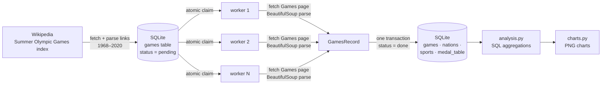
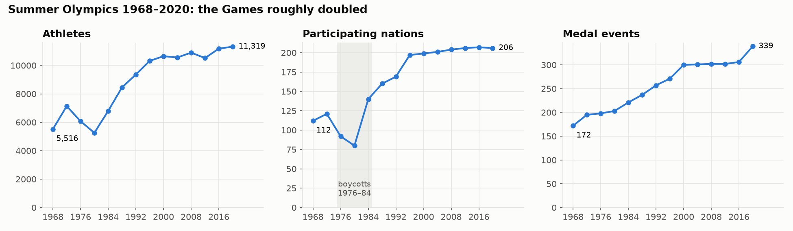
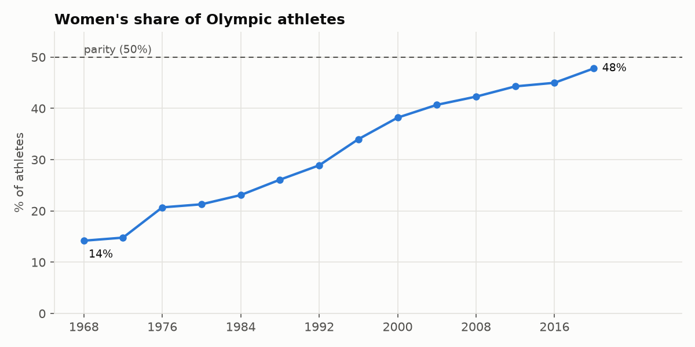
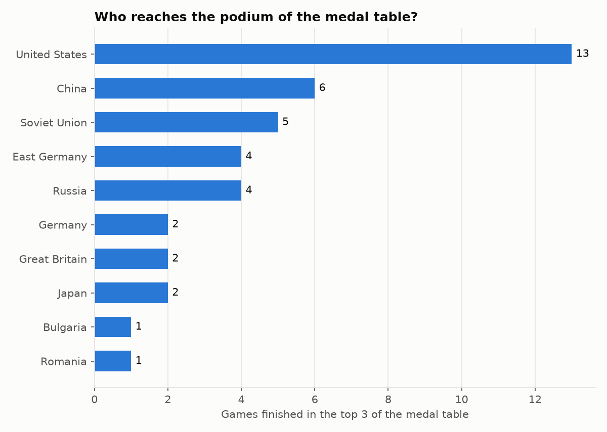
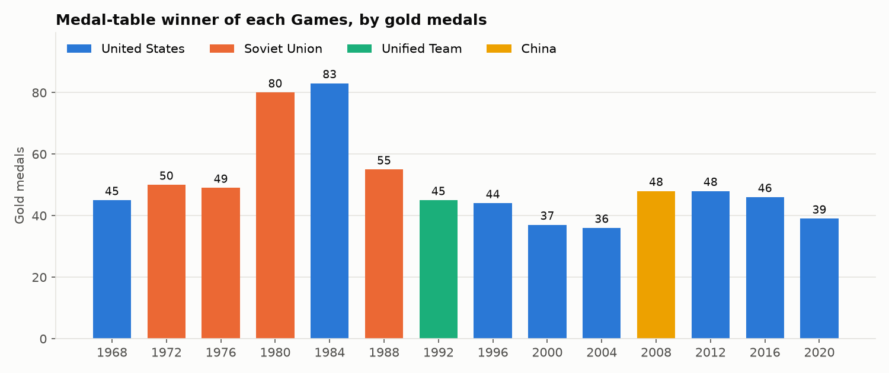

# Summer Olympics Data Extraction & Analysis

 

A concurrent web scraper that collects **every Summer Olympics from 1968 to 2020** from Wikipedia,
stores the results in a normalised **SQLite** database that also serves as the scrapers' work queue,
and analyses **50 years of trends** in participation, gender balance and medal-table dominance.

```
$ python -m olympics scrape --mode threads --workers 4
Queued 14 Games: 1968, 1972, 1976, ..., 2016, 2020
Populated the database in 6.38s (threads, 4 workers)
Queue: done=14
```

## Highlights

| | What | Where |
|---|---|---|
| 🕸️ **Extraction** | BeautifulSoup parser that finds data by *meaning* (infobox labels, navbox names, medal-table headers), not by position, so the same code works on all 14 pages | [`olympics/parse.py`](olympics/parse.py) |
| ⚡ **Concurrency** | One worker loop runs on a **thread pool** or a **process pool**. Workers coordinate only through an atomic SQLite claim. **2.3× faster (57% less time)** with 4 processes, **1.6× (38%)** with 4 threads | [`olympics/scrape.py`](olympics/scrape.py), [`olympics/db.py`](olympics/db.py), [benchmark](docs/benchmark.md) |
| 📈 **Analysis** | SQL aggregations and charts: athletes ×2.05, nations +84%, women from 14% to 48% of athletes, medal-table dominance and host advantage | [`olympics/analysis.py`](olympics/analysis.py), [`olympics/charts.py`](olympics/charts.py) |
| ✅ **Tests** | 19 offline tests: parser checks against saved Wikipedia pages, plus a race test with 8 threads claiming 200 jobs | [`tests/`](tests) |

## Architecture



1. **Discover:** fetch the [Summer Olympic Games](https://en.wikipedia.org/wiki/Summer_Olympic_Games) page and
   collect every link of the form `/wiki/<year>_Summer_Olympics` in the 1968–2020 range.
2. **Queue:** insert one row per Games with `status = 'pending'`.
3. **Scrape (concurrently):** each worker repeatedly *claims* a pending row, downloads the page, parses it and
   saves the result in a single transaction. A worker stops when the queue is empty.
4. **Analyse:** answer questions with SQL and render the charts below.

### Database schema

```
games                 (year PK, url, name, host_city, host_country, nations_count, athletes,
                       athletes_men, athletes_women, events, sports_count,
                       status ∈ {pending, in_progress, done, failed}, error, updated_at)
participating_nations (year → games, nation)          PK (year, nation)
sports                (year → games, sport)           PK (year, sport)
medal_table           (year → games, rank, nation, gold, silver, bronze, total, is_host)
```

Lists such as nations and sports get their own tables instead of a comma-separated text column. That makes
questions like "how often was each nation in the top 3?" a one-line `GROUP BY` rather than string parsing.
Child rows use `ON DELETE CASCADE`, so re-queuing a Games never leaves stale data behind.

## Concurrency design

**The database is the queue.** Each worker claims work with one atomic statement:

```sql
UPDATE games SET status = 'in_progress'
 WHERE year = (SELECT year FROM games WHERE status = 'pending' ORDER BY year LIMIT 1)
RETURNING year, url;
```

Finding and claiming happen in a single write. SQLite serialises writers, so no two workers can ever receive
the same Games. [`tests/test_db.py`](tests/test_db.py) checks this with 8 threads draining 200 jobs. WAL mode
lets readers proceed while a writer commits, and a 30 s busy timeout makes a worker wait for the write lock
instead of failing.

**Workers need no shared state.** Each worker opens its own SQLite connection and its own `requests.Session`
(neither is thread-safe), so the identical `worker_loop` runs sequentially, under `ThreadPoolExecutor`, or under
`ProcessPoolExecutor`. When the executor's `with` block exits, every worker has finished. That answers
"how do we know nobody is still working?" without polling.

**Failures are contained.** Network errors (after 3 retries with exponential backoff) and pages that do not
parse are recorded as `status = 'failed'` with the error message. `python -m olympics status` lists them, and
one bad page never stops the run.

### Benchmark: threads vs processes

Populating the database with all 14 Games pages, median of 3 interleaved runs
([full report](docs/benchmark.md), 16-CPU Windows machine, Python 3.11):

| Configuration | Median | Speed-up | Time saved |
|---|---|---|---|
| sequential | 10.08 s | 1.00× | – |
| 2 threads | 8.00 s | 1.26× | 20.6% |
| 4 threads | 6.23 s | 1.62× | 38.2% |
| 8 threads | 6.27 s | 1.61× | 37.7% |
| **4 processes** | **4.34 s** | **2.32×** | **57.0%** |

**Why do threads plateau at about 38%?** Timing the two phases of one sequential run gives **4.3 s of
downloading** and **5.1 s of BeautifulSoup parsing**. The pages are 0.8–2 MB of HTML each. Threads overlap
the downloads, because the GIL is released while waiting on sockets. Parsing, though, is pure-Python CPU work
that holds the GIL, so it stays serial: roughly 5 s that no number of threads can remove. That matches the
~6.2 s floor above, a textbook case of Amdahl's law. Processes each have their own interpreter and GIL, so
they parallelise the parsing too, despite the cost of starting a process pool on Windows. Switching to the
C-based `lxml` parser only cut parsing from 5.1 s to 4.4 s, because BeautifulSoup's tree building is still
Python, so it wasn't adopted.

> Reproduce with `python -m olympics benchmark`. It uses a separate `data/benchmark.db` and rewrites
> `docs/benchmark.md`. Absolute times depend on the network; compare rows within one report.

## Findings: 50 years of Summer Olympics



**The Games roughly doubled.** Athletes grew from 5,516 to 11,319 (+105%), nations from 112 to 206 (+84%)
and medal events from 172 to 339 (+97%). The only real setback is the **boycott era**: participation fell
to 92 nations in Montreal 1976 (African boycott) and to 80 in Moscow 1980 (US-led boycott), the lowest in
the dataset. It rebounded to 140 in Los Angeles 1984, despite the Soviet-led counter-boycott.



**Near gender parity.** Women made up 14% of athletes in 1968 and 48% in Tokyo 2020, and the share rose at
every single Games.



**One constant at the top.** The United States finished in the medal-table top 3 at 13 of 14 Games. The
exception is 1980, which it boycotted. China, absent until 1984, is second with 6 top-3 finishes.



**Who won the medal table.** The Soviet Union topped the medal table at every Games it attended from
1972 to 1988 (it boycotted Los Angeles 1984). Its successor, the Unified Team, won in 1992. Since then the
United States has won every Games except Beijing 2008. The two outliers, 80 and 83 golds, both come from
boycotted Games.

**Host advantage.** 10 of the 14 hosts finished in their own medal table's top 10, and 4 of them won it
(Soviet Union 1980, United States 1984 and 1996, China 2008).

`python -m olympics analyze` also prints a dataset overview: the years scraped, the nation most often in
the top 3 (**United States**, 13 times) and the average number of athletes per Games (**8,859**).

## Quickstart

```bash
python -m venv .venv
source .venv/bin/activate          # Windows: .venv\Scripts\activate
pip install -r requirements.txt

python -m olympics scrape --mode threads --workers 4   # populate data/olympics.db (~6 s)
python -m olympics status                              # queue state and any failures
python -m olympics analyze                             # print statistics, write docs/images/*.png
python -m olympics benchmark                           # sequential vs threads vs processes
pytest                                                 # offline tests, no network needed
```

Useful options: `--mode sequential|threads|processes`, `--workers N`, and `--sample N --seed S` to scrape a
reproducible random subset of the Games.

## Design decisions & trade-offs

- **Semantic anchors instead of positions.** Lookups like `soup.find_all("table")[6]` break whenever an
  editor adds a table, and page layouts differ between years. The parser instead locates the infobox by its labels ("Athletes",
  "Events"), nations and sports via the standard *"Nations at the YYYY Summer Olympics"* and *"Events at the
  YYYY…"* navboxes, and the medal table by its header row. Names come from the canonical article slug
  (`Soviet_Union_at_the_1980_…`), so the nations list and the medal table join cleanly.
- **SQLite as a work queue.** Zero infrastructure, transactional, and the status column makes a run
  inspectable and resumable. The trade-off: SQLite allows one writer at a time. That's fine here, because
  writes take milliseconds against seconds of network and parsing. At thousands of pages per minute I'd move
  to Postgres (`SELECT … FOR UPDATE SKIP LOCKED`) or a real queue.
- **Parsing is pure.** `parse.py` takes HTML and returns dataclasses, with no I/O, so tests run against
  saved pages in about 2 s with no network access.
- **Being a polite client.** The scraper sends a descriptive User-Agent, uses timeouts, retries with
  backoff, honours `Retry-After`, and caps the number of workers.
- **Known limitations.** If a worker process is killed mid-page, its row is left `in_progress`. A
  production version would add a lease timeout. The navbox sports list includes demonstration sports, so
  `sports_count` comes from the official infobox figure instead.

**What I'd do at larger scale:** `asyncio`/`httpx` for the I/O, plus a process pool sized to the CPU count
for parsing (an async producer feeding CPU workers). I'd also add caching with `ETag`/`If-None-Match` so
re-runs skip unchanged pages, and per-host rate limiting.

## Project structure

```
olympics/
  __main__.py   CLI: scrape | status | analyze | benchmark
  config.py     URLs, year range, paths, network settings
  fetch.py      requests.Session with retries and a descriptive User-Agent
  parse.py      HTML -> GamesRecord (pure, no I/O)
  models.py     dataclasses shared across layers
  db.py         schema, atomic work-queue operations, persistence
  scrape.py     worker loop; sequential / thread-pool / process-pool runners
  analysis.py   SQL aggregations for the findings
  charts.py     matplotlib charts for the README
  benchmark.py  timing harness and Markdown report
tests/          parser (on saved pages), database queue, analysis
docs/           benchmark report and chart images
```
